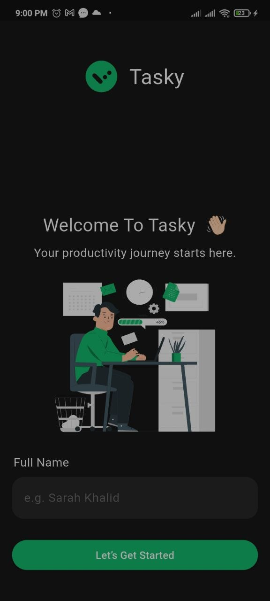
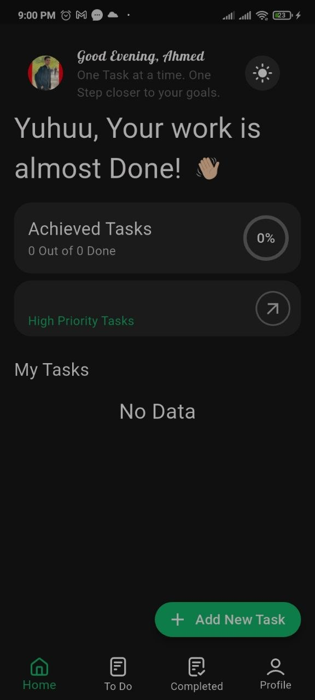
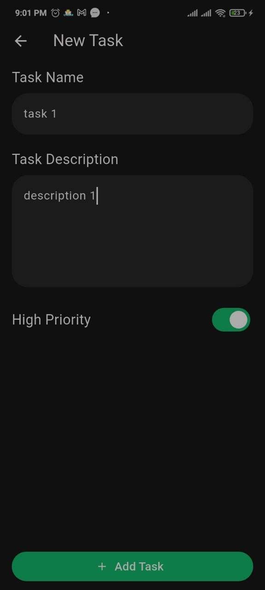
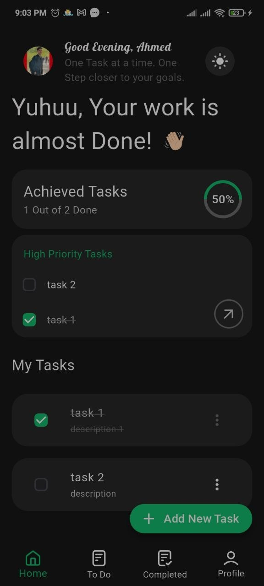
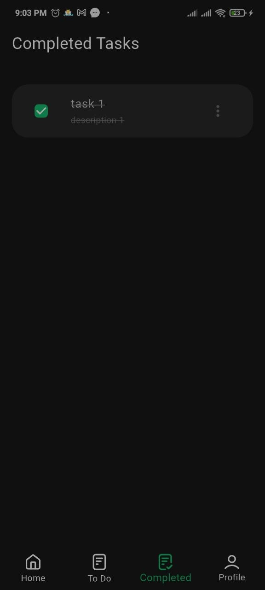
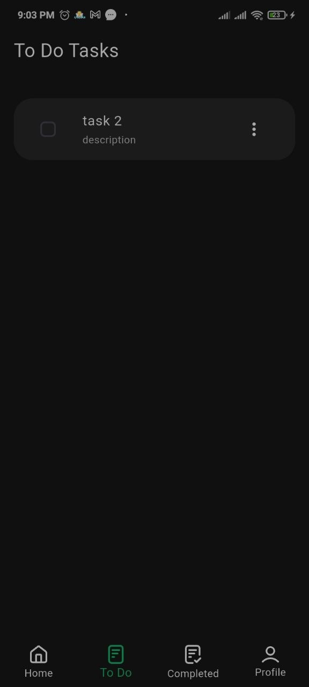
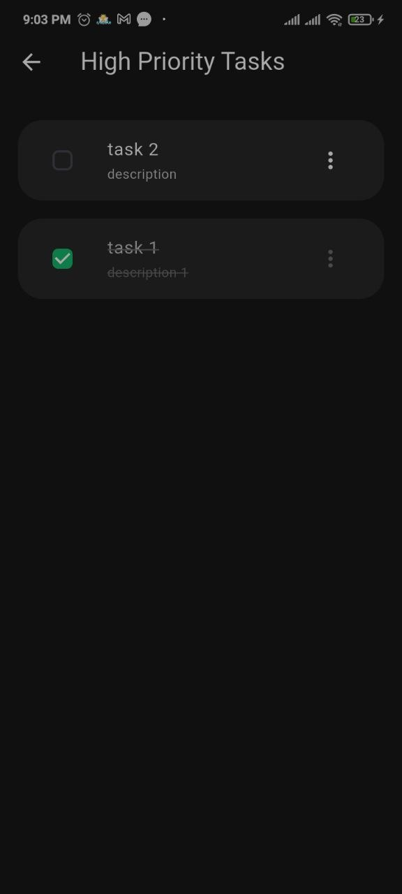
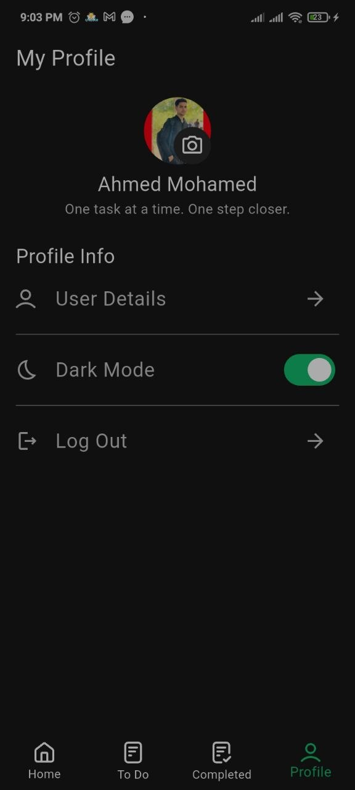

# Tasky - Flutter Task Management App

A task management mobile application built with **Flutter and Dart** to help users organize and track their daily tasks.

**Project Status:** Under Development

## Features

- **Add Tasks:** Create new tasks.
- **Edit Tasks:** Update existing task details.
- **Delete Tasks:** Remove unwanted tasks.
- **Complete Tasks:** Mark tasks as completed.
- **Task Filtering:** Filter tasks based on their status.
- **Local Storage:** Save tasks locally using SharedPreferences.

## Technologies Used

- **Flutter** – Mobile application development.
- **Dart** – Programming language.
- **SharedPreferences** – Local data persistence.

## 📸 Screenshots

| Welcome                             | Home 1                           | Add Task                              |
| ----------------------------------- | -------------------------------- | ------------------------------------- |
|  |  |  |

| Home 2                           | Completed                               | To-Do                           |
| -------------------------------- | --------------------------------------- | ------------------------------- |
|  |  |  |

| High Priority                                   | Profile                             |
| ----------------------------------------------- | ----------------------------------- |
|  |  |

## Getting Started

1. Clone the repository:

   ```bash
   git clone https://github.com/Ahmed-M-Khedr/flutter-tasky-app.git
   ```

2. Navigate to the project directory:

   ```bash
   cd flutter-tasky-app
   ```

3. Install dependencies:

   ```bash
   flutter pub get
   ```

4. Run the application:

   ```bash
   flutter run
   ```

## Future Improvements

Additional features and UI improvements are planned as development continues.

## Developer

**Ahmed Mohamed Khedr**

- [GitHub](https://github.com/Ahmed-M-Khedr)
- [LinkedIn](https://www.linkedin.com/in/ahmedkhedr172)
